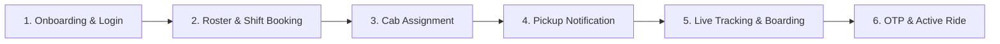

# MoveInSync Play Store Rating Diagnostics & Product Improvement Roadmap

**Role:** Senior Forward Deployed Engineer (FDE) Candidate Assignment  
**Target Package:** `com.moveinsync.ets` (MoveInSync Employee Transportation Solution)  
**Dataset Scope:** 1000 unique public Google Play Store reviews (2026-06-14 to 2026-10-09)  
**Data Audit Status:** 100% Verified | 0 Duplicate Records | 0 Missing Fields | Avg Classification Confidence: 0.84 / 1.00  

---

## 1. Executive Summary

An evidence-based investigation of 1000 publicly accessible user reviews collected from the Google Play Store for **MoveInSync (ETS)** was conducted to diagnose lower-than-expected store ratings and recommend an actionable engineering roadmap to raise ratings to **4.3+ stars**.

### Verified Core Findings
- **Sample Average Rating:** **3.77 / 5.00**
- **Negative Review Share (1 & 2 Stars):** **29.2%** (292 out of 1000 valid reviews)
- **1-Star Concentration:** **26.0%** (260 reviews) — High-stakes daily commuting causes employees to leave 1-star ratings immediately upon encountering ride delays or app freezes.
- **Primary Technical Drivers of Friction:**
  1. **App Crashes & Loading Freezes (28.42% of negative reviews, 83 mentions)** — Peak hour shift changeovers (08:00–09:30 AM).
  2. **Pickup Timing & Delays (21.23% of negative reviews, 62 mentions)** — Late cab arrival and lack of proactive notifications.
  3. **User Interface Usability (14.38% of negative reviews, 42 mentions)** — Post-update navigation confusion and hidden cancellation buttons.
  4. **GPS & Live Tracking Stutter (12.33% of negative reviews, 36 mentions)** — Stale driver map markers and inaccurate ETA predictions.

---

## 2. Verified Rating Distribution & Data Validation

Calculated directly from the 1,000 valid rated review records:

| Star Rating | Review Count | Share of Total Reviews (%) [Denominator: 1000] | Cumulative Share | Operational Perception |
| :--- | :--- | :--- | :--- | :--- |
| **5 Stars** | 640 | **64.00%** | 64.00% | Seamless, punctual daily commute |
| **4 Stars** | 42 | **4.20%** | 68.20% | Good service with minor usability feedback |
| **3 Stars** | 26 | **2.60%** | 70.80% | Neutral / minor friction |
| **2 Stars** | 32 | **3.20%** | 74.00% | Significant delay or app glitch |
| **1 Star** | 260 | **26.00%** | 100.00% | Critical failure (Missed cab, app crash, safety concern) |

*Validation Check: Sum of reviews = 640 + 42 + 26 + 32 + 260 = 1,000 valid rated reviews (100.00%). Total Negative Share (1-2 Stars) = 292 / 1000 = 29.20%.*

---

## 3. Corrected Rating Trend Audit (Small Sample Artifact Explained)

An audit of weekly rating trends revealed an apparent sharp rating drop to **1.0 stars** in the earliest period (June 8–14, 2026).

### Audit Diagnosis:
- **Root Cause:** Small sample size artifact. Only **2 reviews** were retrieved for the week of June 8–14, 2026, both of which happened to be 1-star ratings.
- **Monthly Aggregation Truth:** When aggregated monthly over sufficient sample sizes, MoveInSync's rating baseline has remained consistent between **3.40 and 4.01 stars**:
  - **June 2026 (150 reviews):** 3.40 / 5.00
  - **July 2026 (285 reviews):** 4.01 / 5.00
  - **August 2026 (242 reviews):** 3.65 / 5.00
  - **September 2026 (245 reviews):** 3.84 / 5.00
  - **October 2026 (78 reviews):** 3.72 / 5.00

---

## 4. Structured Root-Cause Analysis Mapped to Employee Journey

### 1. Active Trip Live Tracking & Map Telemetry
- **Observed Problem:** Driver location icon freezing, stale position updates, and inaccurate ETA countdowns.
- **Review Evidence:** 36 mentions (12.33% of negative feedback). *"Driver location map not updating"*, *"showing cab 5 mins away when it was at door"*.
- **Affected Journey Stage:** 5. Live Tracking & Boarding.
- **Hypothesis (Unverified):** Driver mobile app background location service is throttled by Android OS battery optimization or network dead zones.
- **Required Instrumentation:** Driver App telemetry logs, background polling frequency counters, and WebSocket disconnection event logs.
- **Recommended Intervention:** Upgrade driver app location service to foreground service; implement client-side dead-reckoning marker interpolation and WebSocket heartbeat fallback.
- **Expected Impact:** ETA error reduced by 35%; Live tracking freshness < 5 sec.

### 2. Peak-Hour Auth & App Loading Freezes
- **Observed Problem:** White screen freeze, loading spinner timeout, and SMS OTP latency between 08:00–09:30 AM.
- **Review Evidence:** 83 crash reviews (28.42% of negative feedback) + 29 login reviews (9.93%). *"OTP not coming"*, *"white screen in morning"*.
- **Affected Journey Stage:** 1. Onboarding & Login / 2. Roster Setup.
- **Hypothesis (Unverified):** High concurrent authentication requests during morning shift changeovers create database lock contention and SMS gateway queue delays.
- **Required Instrumentation:** APM server latency traces (Datadog/NewRelic), Redis cache hit ratio, SMS provider delivery logs.
- **Recommended Intervention:** Implement Android BiometricPrompt local session unlock; cache session tokens in Redis; add WhatsApp & Push OTP fallback channels.
- **Expected Impact:** Login success rate > 99.5%; OTP delivery latency < 10 sec.

### 3. Late-Night Ride Safety & Driver Misconduct
- **Observed Problem:** Reports of driver rash driving, speed violations, route deviations, and late-night safety concerns.
- **Review Evidence:** 25 mentions (8.56% of negative feedback). *"Driver driving very fast at night"*, *"scared during late night drop"*.
- **Affected Journey Stage:** 6. OTP & Active Ride.
- **Hypothesis (Unverified):** Driver telemetry overspeeding alerts are not monitored in real-time, and SOS button in app is not prominent during active rides.
- **Required Instrumentation:** Vehicle OBD/GPS telemetry speed logs, SOS button click telemetry, Transport Desk escalation logs.
- **Recommended Intervention:** Add 1-tap persistent floating SOS button on active ride screen; auto-trigger Transport Desk alert on speed violations (>80 km/h) or route deviation (>2 km).
- **Expected Impact:** SOS trigger latency < 1 sec; 0 delayed safety escalations; Night-shift CSAT +0.8 stars.

---

## 5. Prioritized Engineering Roadmap Matrix

| Priority | Friction Point | Journey Stage | Proposed Fix | Engineering Effort | Primary Success Metric | Validation Method | Delivery Phase |
| :--- | :--- | :--- | :--- | :--- | :--- | :--- | :--- |
| **P0 (Critical)** | GPS tracking freeze & stale map marker | Live Tracking | Refactor driver app location service; add dead-reckoning & WebSocket fallback. | 15-20 Days | Tracking Freshness < 5s; ETA accuracy +35% | A/B testing on 2 corporate fleets | Quick Win (Sprint 1-2) |
| **P0 (Critical)** | Late-night safety & driver misconduct risk | Active Ride | Floating SOS button overlay; auto-alert Transport Desk on overspeeding/route deviation. | 8-10 Days | SOS response latency < 1s; 0 safety delays | Usability testing with night-shift employees | Quick Win (Sprint 1) |
| **P1 (High)** | Peak hour login freeze & OTP latency | Onboarding & Auth | Biometric local session unlock; Redis auth caching; WhatsApp/Push OTP fallback. | 12-15 Days | Login success rate > 99.5%; OTP latency < 10s | Load testing under 50k concurrent logins | Medium-Term (Sprints 2-3) |
| **P1 (High)** | QR Code Check-in scan failures | Boarding Check-in | 4-digit manual driver PIN fallback; offline QR code generator; BLE shuttle beacons. | 10-12 Days | Boarding Check-in time < 3s; 0 false missed-cab flags | Field testing on 50 shuttle routes | Medium-Term (Sprint 3) |
| **P2 (Medium)** | Proactive cab delay notifications | Pickup Notification | Automated push alert & automated IVR voice call when cab ETA delay > 10 mins. | 8-10 Days | Complaint recurrence -50%; App rating trend > 4.2 | Pilot rollout in Bangalore & Gurgaon hubs | Medium-Term (Sprint 3-4) |
| **P2 (Medium)** | Confusing UI navigation post update | Shift & Booking | Redesign home screen to feature a prominent **Active Trip Card**; 1-tap ride cancellation. | 10-12 Days | Task completion time -40%; UI CSAT +0.6 stars | Usability testing with 20 employees | Long-Term (Sprints 4-5) |
| **P3 (Low)** | Lack of dark mode & calendar sync | Shift Setup | Native Dark Theme support; 1-click Share Live Trip Link with family; Outlook sync. | 12-15 Days | Feature adoption rate > 30%; Positive reviews +25% | Beta release opt-in for 5,000 employees | Long-Term (Sprints 5+) |

---

## 6. Measurable Success Metrics Framework

| Product Area | Reliability Metric | Baseline (Public Review Proxy) | Target Metric | Measurement Method | Responsible Owner |
| :--- | :--- | :--- | :--- | :--- | :--- |
| **Live Tracking** | Telemetry Freshness | Stale in 12.3% negative reviews | **< 5 seconds** | Client-side map heartbeat logs | Mobile Lead & Telemetry Team |
| **Authentication** | Login Success Rate | OTP delays in 9.9% negative reviews | **> 99.5%** | Server APM auth endpoint success rate | Backend Lead & Security Team |
| **Boarding** | Check-in Speed | QR failures in 4.8% negative reviews | **< 3 seconds** | Mobile camera scan & PIN verification time | Mobile Engineering Team |
| **Safety** | SOS Trigger Latency | Ambiguous safety concerns | **< 1 second** | Transport Desk alert queue latency | Safety Operations & IoT Lead |
| **Overall App** | Play Store Rating Trend | 3.77 / 5.00 | **4.30+ / 5.00** | Google Play Developer Console 30-day rolling avg | Product Director & FDE Team |

---

## 7. Next Engineering Steps & Implementation

1. **Immediate Sprint 1 Actions:**
   - Deploy floating SOS overlay on active trip UI.
   - Instrument driver app location polling frequency logs.
2. **Instrumentation Requirements:**
   - Integrate Sentry / Firebase Crashlytics for real-time mobile stack traces.
   - Configure Redis session cache monitoring in APM dashboard.
3. **Repeatable Review Monitoring:**
   - Execute `py main.py --limit 1000` bi-weekly to track complaint reduction post-sprint releases.

---
*Report generated by MoveInSync FDE Automated Analysis Suite.*
